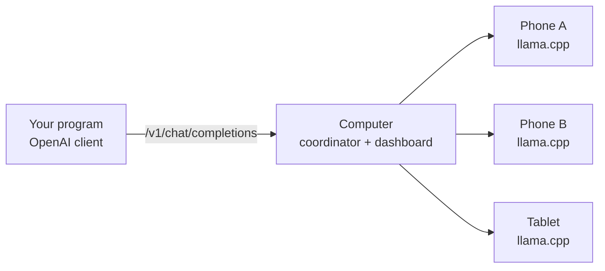

# Phone Cluster

[Español](README.md) · **English**

Turn several Android phones into **one AI server** that your computer
exposes through the OpenAI API. Each phone runs a language model with
[llama.cpp](https://github.com/ggml-org/llama.cpp), and the computer shares
the work between them.

To any program that talks to OpenAI, the cluster is just another endpoint:

```
http://<your-computer-IP>:7800/v1
```

## How it works



- **The computer (coordinator)** receives the requests and picks the least busy
  phone. If one fails, it retries on another. A web dashboard shows each
  phone's battery, temperature, RAM and speed.
- **Each phone** runs the *Phone Cluster* app. The app downloads the model
  from the computer, runs it, and reports its state every few seconds.
- **Phone protection:** the computer stops sending work to a phone that is too
  hot or low on battery, and sends work again once it recovers.

### Two modes

| Mode | What it does | When to use it |
|---|---|---|
| **Normal** | Every phone holds the full model and serves whole requests. | Models that fit on one phone. More phones = more requests at once. |
| **Split** | The model's layers are spread across the phones and the computer chains them. | Models that **don't fit** on a single phone. It is slower, because every token crosses the Wi-Fi. |

To use split mode, turn it on in the dashboard and request the model whose
name ends in `-dividido`.

## Platforms

The coordinator is written in Rust and should run on any computer with
macOS or Linux; it has only been tested on macOS. These parts are
currently prepared for the Mac only:
- the desktop app;
- the build script;
- the split-mode head.

On other systems, start the coordinator from the terminal. The command is
below.

## Getting started (Mac)

**You need:**
- an Apple Silicon Mac with [Rust](https://rustup.rs);
- Android Studio, with SDK, NDK and CMake;
- `cargo install tauri-cli`;
- Android 10+ (arm64) phones on the **same Wi-Fi** as the computer.

```sh
# 1. Build the Android app and llama.cpp, and download the model (once)
tools/build-android.sh

# 2. Build and open the Mac app
cd apps/desktop && cargo tauri build --bundles app
open "../../target/release/bundle/macos/Phone Cluster.app"
```

3. On the phone, scan the dashboard's **QR code**, tap **Descargar la app**
   (download the app), install it and open it.
4. On the dashboard, click **Aceptar** (accept). The phone downloads the
   model and becomes **Ready**.
5. Try it:

```sh
curl http://<your-computer-IP>:7800/v1/chat/completions \
  -H 'content-type: application/json' \
  -d '{"model":"auto","messages":[{"role":"user","content":"Hello"}]}'
```

The `x-pc-node` response header tells you which phone answered.

The first time, macOS asks for the **Local Network** permission for the app.
Without it, the app can't talk to the phones.

On Linux, or without the desktop app? Run the coordinator on its own:
`cargo run --release -p pc-coordinator -- --config coordinator.toml`. First
copy `coordinator.example.toml` and change the token.

The user interface (dashboard and apps) is in Spanish.

## Layout

| Folder | What it is |
|---|---|
| `crates/pc-coordinator` | Coordinator: OpenAI API, scheduling, web dashboard, split mode |
| `crates/pc-agent` | Phone agent: metrics and llama.cpp supervision |
| `crates/pc-proto` | Agent ↔ coordinator protocol |
| `apps/desktop` | Mac app (Tauri) |
| `android-app` | Android app |
| `tools/` | Build script and a fake llama-server for tests |

Design decisions, and the reasons behind them, are in
[DECISIONS.md](DECISIONS.md) (in Spanish).

## Caveats

This is an **experimental** project, meant for your home or office network.
- The dashboard only answers on the computer itself.
- All phones share the same token.
- Split mode uses llama.cpp's `rpc-server`, which has no authentication.

Use it only on a **trusted network**. Details in [DECISIONS.md](DECISIONS.md)
(D-56, D-59).
