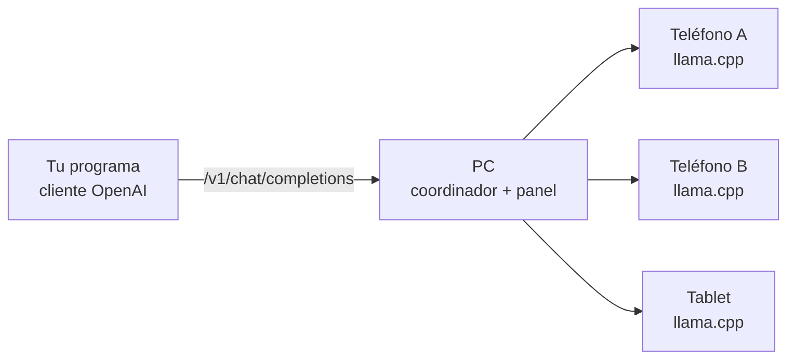

# Phone Cluster

**Español** · [English](README.en.md)

Convierte varios teléfonos Android en **un solo servidor de IA** que tu PC
expone con la API de OpenAI. Cada teléfono ejecuta un modelo de lenguaje con
[llama.cpp](https://github.com/ggml-org/llama.cpp), y el PC reparte el
trabajo entre ellos.

Para cualquier programa que hable con OpenAI, el cluster es un endpoint más:

```
http://<IP-de-tu-PC>:7800/v1
```

## Cómo funciona



- **El PC (coordinador)** recibe las peticiones y elige el teléfono más
  libre. Si uno falla, reintenta en otro. Tiene un panel web para ver cada
  teléfono: batería, temperatura, RAM y velocidad.
- **Cada teléfono** lleva la app *Phone Cluster*. La app descarga el modelo
  desde el PC, lo ejecuta y le avisa cada pocos segundos de cómo está.
- **Protección del teléfono:** el PC deja de enviar trabajo a un teléfono
  caliente o con poca batería, y se lo devuelve cuando se recupera.

### Dos modos

| Modo | Qué hace | Cuándo conviene |
|---|---|---|
| **Normal** | Cada teléfono tiene el modelo completo y atiende peticiones enteras. | Modelos que caben en un teléfono. Más teléfonos = más peticiones a la vez. |
| **Dividido** | Las capas del modelo se reparten entre los teléfonos y el PC las encadena. | Modelos que **no caben** en un solo teléfono. Es más lento, porque cada token cruza la Wi-Fi. |

Para usar el modo dividido, actívalo en el panel y pide el modelo que termina
en `-dividido`.

## Plataformas

El coordinador es Rust y debería funcionar en cualquier PC con macOS o
Linux; solo lo hemos probado en macOS. Lo que hoy está preparado solo para
Mac:
- la app de escritorio;
- el script de compilación;
- la cabeza del modo dividido.

En otros sistemas, arranca el coordinador desde la terminal. Abajo está el
comando.

## Puesta en marcha (Mac)

**Necesitas:**
- un Mac con Apple Silicon y [Rust](https://rustup.rs);
- Android Studio, con SDK, NDK y CMake;
- `cargo install tauri-cli`;
- teléfonos Android 10+ (arm64) en la **misma Wi-Fi** que el PC.

```sh
# 1. Compila la app Android, llama.cpp y descarga el modelo (una vez)
tools/build-android.sh

# 2. Compila y abre la app del Mac
cd apps/desktop && cargo tauri build --bundles app
open "../../target/release/bundle/macos/Phone Cluster.app"
```

3. En el teléfono, escanea el **QR** del panel, pulsa **Descargar la app**,
   instálala y ábrela.
4. En el panel, pulsa **Aceptar**. El teléfono descarga el modelo y
   queda en **Ready**.
5. Pruébalo:

```sh
curl http://<IP-de-tu-PC>:7800/v1/chat/completions \
  -H 'content-type: application/json' \
  -d '{"model":"auto","messages":[{"role":"user","content":"Hola"}]}'
```

La cabecera `x-pc-node` de la respuesta dice qué teléfono contestó.

La primera vez, macOS pedirá el permiso **Red local** para la app: sin él no
puede hablar con los teléfonos.

¿En Linux, o sin app de escritorio? Arranca solo el coordinador:
`cargo run --release -p pc-coordinator -- --config coordinator.toml` (copia
antes `coordinator.example.toml` y cambia el token).

## Estructura

| Carpeta | Qué es |
|---|---|
| `crates/pc-coordinator` | Coordinador: API OpenAI, reparto, panel web, modo dividido |
| `crates/pc-agent` | Agente del teléfono: métricas y supervisión de llama.cpp |
| `crates/pc-proto` | Protocolo entre agente y coordinador |
| `apps/desktop` | App de Mac (Tauri) |
| `android-app` | App Android |
| `tools/` | Script de compilación y un llama-server falso para pruebas |

Las decisiones de diseño, con su porqué, están en [DECISIONS.md](DECISIONS.md).

## Avisos

Es un proyecto **experimental**, pensado para tu red de casa o de trabajo.
- El panel solo responde en el propio PC.
- Todos los teléfonos comparten el mismo token.
- El modo dividido usa el `rpc-server` de llama.cpp, que no tiene
  autenticación.

Úsalo solo en una **red de confianza**. Detalles en
[DECISIONS.md](DECISIONS.md) (D-56, D-59).
